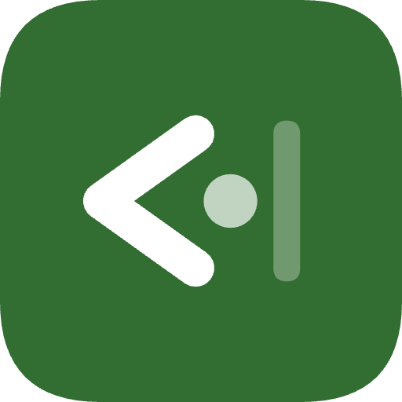

# EdgeX

> A tribute to Xposed Edge. EdgeX is an LSPosed/Xposed module for Android 15+ that hooks system input in `system_server` to handle edge gestures, hardware keys, and common Android actions.

  

  
  
  

  <strong><a href="https://edgexy.app/">Website</a></strong>
  &nbsp;·&nbsp;
  <strong><a href="README_CN.md">中文</a></strong>

## Preview

  
  &nbsp;&nbsp;&nbsp;&nbsp;&nbsp;&nbsp;&nbsp;&nbsp;&nbsp;&nbsp;&nbsp;&nbsp;&nbsp;&nbsp;&nbsp;&nbsp;&nbsp;&nbsp;&nbsp;&nbsp;&nbsp;&nbsp;&nbsp;&nbsp;&nbsp;&nbsp;&nbsp;&nbsp;
  

## Overview

EdgeX runs its gesture and key logic inside `system_server` through LSPosed/Xposed instead of using a floating-window app. The work is split across two processes:

- `android` (system_server): edge touch handling, hardware key interception, action dispatch, freezer drawer, clipboard history overlay, universal copy overlay, and other system overlays.
- `com.fan.edgex`: settings UI and cross-process configuration storage.

It is built for rooted LSPosed users who want Xposed Edge-style shortcuts on modern Android, including Back, Home, Recents, screenshots, app launch, app shortcuts, shell commands, a freezer drawer, clipboard history, and universal copy.

## Non-root version

If you want edge gestures without root or LSPosed, try EdgeY, the non-root version of this project:

[EdgeY on Google Play](https://play.google.com/store/apps/details?id=com.fan.EdgeY)

## Features

- Segmented left, right, top, and bottom edge zones, plus full-edge low-priority zones.
- Single tap, double tap, long press, and direction-aware swipe events.
- Click, double-click, and long-press actions for Volume Up, Volume Down, and Power.
- System actions: Back, Home, Recents, notifications, lock screen, screenshot, volume, brightness, and more.
- App and shortcut launching, with a root fallback when shortcut discovery is restricted.
- Radial Pie menus and custom panels opened from gestures or keys.
- Saved multi-action combinations and conditional actions.
- Direct switching to the previous or next recent app.
- Side freezer drawer to manage frozen apps, unfreeze and launch them, and refreeze them afterward.
- Clipboard history overlay showing the last 50 entries; tap an entry to inject it into the focused field, or delete individual entries.
- Universal copy overlay to collect accessible text from the current screen and copy selected blocks.
- Custom shell commands bound to gestures or keys, with optional `su` execution.
- Media controls: play/pause, stop, previous track, and next track.
- Gesture-zone debug overlay, SystemUI restart shortcut, haptic feedback, and configurable accent colors.

## Requirements

- Android 15 or later.
- LSPosed / Xposed environment with Xposed API 82+.
- Current build config: `minSdk 35`, `targetSdk 36`, `compileSdk 36`.
- Required LSPosed scope: `android` / System Framework (system_server).

### Root notes

- Freezing and unfreezing apps usually requires root. EdgeX uses framework access where possible and falls back to `su` where needed.
- EdgeX loads app shortcuts through Android APIs first. If access is restricted, it may use `dumpsys shortcut`, which usually requires root.
- Shell commands need root only when the command itself requires it or when the action is configured to run through `su`.
- ROM changes, SELinux policy, and LSPosed runtime behavior can affect individual actions.

## Installation

1. Install the EdgeX APK.
2. Enable EdgeX in LSPosed.
3. Select the `android` (System Framework) scope.
4. Reboot the device. Do a full reboot after first activation or after changing scopes.
5. Open EdgeX, enable gestures or keys, and assign actions.

## Usage tips

- Turn on debug mode first to see where edge zones are detected.
- If gestures do not trigger, check the LSPosed scope, verify that the module is enabled, and make sure you rebooted after enabling it.
- If freezer or shortcut fallback actions fail, check `su` authorization and your root manager logs.
- Use the in-app SystemUI restart option if overlays or system actions need a quick refresh.

## Tested environment

| Device                 | Android | Xposed environment                                             | Root solution                                 |
|------------------------|---------|----------------------------------------------------------------|-----------------------------------------------|
| Pixel 9                | 16      | [`LSPosed 1.9.2-it(7455)`](https://github.com/LSPosed/Lsposed) | [KernelSU](https://github.com/tiann/KernelSU) |
| Android Virtual Device | 16      | [`Vector 2.0(3021)`](https://github.com/JingMatrix/Vector)     | [Magisk](https://github.com/topjohnwu/Magisk) |

These are the setups tested during development. Other devices and ROMs are not excluded, though some may need extra adaptation.

## Reporting issues

When opening an issue, include:

- Device model, Android version, and ROM.
- LSPosed / Xposed version.
- Enabled scopes.
- Trigger path, for example `Mid-Right Edge, Swipe Left`.
- Xposed logs and reproduction steps.

## Support

If you find EdgeX useful, you can support development via [Ko-fi](https://ko-fi.com/fantasy1999).

## Credits

EdgeX is inspired by Xposed Edge and reimplements its interaction model for Android 15+ and current LSPosed environments.

## License

This project is licensed under the [GNU General Public License v3.0](LICENSE).
